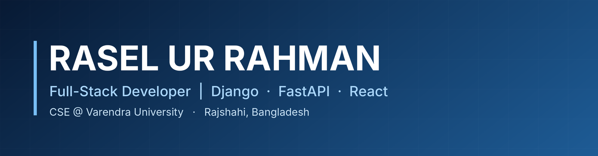

  

  <a href="https://www.linkedin.com/in/raselurrahman/">LinkedIn</a> &nbsp;|&nbsp;
  <a href="https://raselurrahman0.github.io/Protfolio-website/">Portfolio</a> &nbsp;|&nbsp;
  <a href="mailto:raselurrahman1@gmail.com">Email</a>

---

## About

CSE student at **Varendra University** (B.Sc. expected June 2027) and **Ostad-certified Full-Stack Developer**. I build web applications with Django, FastAPI, React and MySQL, and I am comfortable on the support side too: networking, Linux and tracing problems back to their cause.

**Open to:** Software Developer, Management Software and Technical Support roles.

---

## Skills

| | |
|---|---|
| **Languages** | Python, JavaScript, C++, HTML, CSS |
| **Frameworks** | Django, Django REST Framework, FastAPI, React, RTK Query |
| **Database & Tools** | MySQL, Git, GitHub, VS Code |
| **Security & APIs** | REST API, JWT Authentication, Google OAuth, Two-Factor Auth |
| **Networking** | TCP/IP, OSI Model, DNS, DHCP, Subnetting, VLAN, Static & Dynamic Routing |
| **Systems** | Linux (Ubuntu), File Permissions, Shell Scripting |
| **Hardware & Signals** | Digital Logic, Microcontroller Fundamentals, MATLAB/Simulink, FFT |
| **Soft Skills** | Communication, Teamwork, Critical Thinking, Problem Solving, Time Management |

---

## Projects

| Project | Description | Stack |
|---|---|---|
| **Devport** | Course marketplace where students buy courses online and teachers publish their own. Fully responsive. | Web App |
| **Medical Report Analyzer** | Analyzes medical reports. Built within the time limit at the AI Launchpad Hackathon. | Web App, AI |
| **User Management System** | Registration, login, Google OAuth, password recovery, two-factor auth and account deletion. | Django REST, React, RTK Query |
| **FFT Bridge Vibration Analyzer** | Finds a bridge's dominant vibration frequencies using FFT, low-pass filtering and spectrum analysis. | MATLAB, Simulink |
| **Portfolio Website** | Personal site showcasing my projects and skills. | [View live](https://raselurrahman0.github.io/Protfolio-website/) |

<!-- Add links later: [Code](REPO_URL) | [Live](LIVE_URL) -->

---

## Currently

- Research: privacy risks in Retrieval-Augmented Generation (RAG) systems
- Learning: web application security, networking and Linux security
- Building: full-stack projects with clean APIs and secure login flows

---

## Background

| | |
|---|---|
| **Education** | B.Sc. in CSE, Varendra University (expected June 2027) |
| **Certifications** | Full Stack Web Development, Ostad (2026) · AI Launchpad Hackathon · Tech Debate 4.0 |
| **Activities** | Founding Member, VUNC (Networking & Cyber Security Club) · Member, VURC (Research Club) · Chess rating 1400 |
| **Languages** | Bangla (Native) · English (Professional) |

---

## Contact

| | |
|---|---|
| **Email** | [raselurrahman1@gmail.com](mailto:raselurrahman1@gmail.com) |
| **Phone** | [+880 1742-767562](tel:+8801742767562) |
| **Location** | Rajshahi, Bangladesh |
| **LinkedIn** | [linkedin.com/in/raselurrahman](https://www.linkedin.com/in/raselurrahman/) |
| **Portfolio** | [raselurrahman0.github.io/Protfolio-website](https://raselurrahman0.github.io/Protfolio-website/) |
